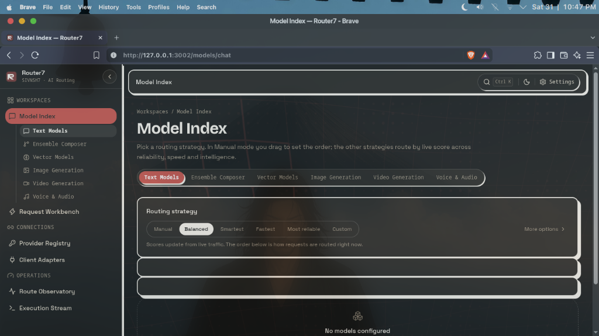

<div align="center">

# 🌐 Router7

### Intelligent Multi-Provider AI Gateway, Resilient Failover Proxy & Model Orchestrator

**Unify 35+ LLM providers, 600+ model endpoints, and local inference into a single, lightning-fast, OpenAI-compatible `/v1` gateway.**

[](./LICENSE)
[](https://github.com/sivnsh7/router7/stargazers)
[](https://github.com/sivnsh7/router7/issues)
[](https://www.npmjs.com/package/router7)
[](./docker)

---

[Key Features](#-key-features) · [Quick Start](#-quick-start) · [Start Server & GUI (`r7`)](#-start-server--gui-dashboard-r7--router7) · [Authentication & Access Modes](#-authentication--access-modes) · [Architecture](#-architecture) · [API Reference](#-api-reference) · [Supported Providers](#-supported-providers) · [Coding Agents & IDEs](#-coding-agents--ide-integrations) · [Contributing](#-contributing)

<br/><br/>

<a href="https://github.com/sivnsh7/router7">
  
</a>

</div>

---

## ⚡ What is Router7?

**Router7** is a high-performance, local-first AI Gateway designed to eliminate rate limits, provider downtime, and vendor lock-in. Instead of managing separate SDKs, billing accounts, and error handling for OpenAI, Anthropic, Google Gemini, Groq, Cerebras, Mistral, Cohere, DeepSeek, and Ollama, Router7 provides **one unified API endpoint** that automatically handles routing, fallbacks, token budgeting, and multi-model synthesis.

Point your existing OpenAI SDK, LangChain, LlamaIndex, Cursor, Claude Code, Cline, or custom agent at `http://localhost:3001/v1`, and Router7 dynamically directs each prompt to the fastest, cheapest, or smartest candidate in your pool.

---

## 🌟 Key Features

### 1. 🔄 Automatic Failover & Zero-Downtime Resilience
- **Instant Fallback**: If an upstream provider rate-limits (HTTP 429), errors (5xx), or throttles latency, Router7 transparently routes the request to the next candidate model in your fallback chain without dropping your stream.
- **Modality Capacity Auto-Rescue**: If a coding harness or agent sends image or audio inputs to a text-only model or alias, Router7 automatically rescues the request by forwarding it to the highest-ranking multimodal-capable model in your pool without failing.
- **Provider Key Rotation & Live Cooldowns**: Distribute requests across multiple API keys. Keys placed on cooldown display real-time countdown badges (`⏱ 45s`) with instant 1-click **Reset Cooldown** buttons per key or per platform.

### 2. 🗂️ Tactical Field Dossier & Intelligence Matrix
- **Two-Column Gateway Architecture**: Every provider features a high-density, tactile Field Dossier separating the **Credentials Vault** (keys, proxies, latency ping probes, quota gauges) from the **Served Models Matrix** (capabilities, inline model latency benchmarks, and alias controls).
- **Thinking Level Knob**: Configure default reasoning thinking budgets (`Auto`, `Low`, `Medium`, `High`, `Max`) per provider or model, automatically mapped across OpenAI `reasoning_effort`, Anthropic thinking tokens, and Gemini thinking budgets.
- **Status-Weighted Priority Sorting**: Providers automatically sort by operational health: Active & Healthy first, Attention/Cooldown second, and Unconfigured last, backed by instant filter tabs (`All`, `Healthy`, `Attention`, `Disabled`).

### 3. 🧠 Dynamic Routing Strategies
Switch between 6 smart routing strategies on the fly:
- **Fastest**: Prioritizes minimum Time-To-First-Token (TTFT) and throughput.
- **Smartest**: Prioritizes reasoning depth and model intelligence scores.
- **Balanced**: Optimal balance between response speed, reasoning power, and reliability.
- **Most Reliable**: Routes only through historically healthiest providers with lowest error rates.
- **Manual**: Strict user-defined chain priority ordering.
- **Custom Weights**: Fine-tune custom weight percentages for Speed, Intelligence, and Stability.

### 4. 🧪 Ensemble Composer & Fusion (Multi-Model Synthesis)
- Send prompts to the virtual `fusion` model to fan requests out to multiple diverse models simultaneously.
- An evaluator/judge model synthesizes the drafts into one authoritative, hallucination-reduced response.

### 5. 🎨 Comprehensive Multimodal Suite
Router7 translates standard REST requests across all major modalities:
- **Chat & Reasoning**: Full OpenAI `/v1/chat/completions` compatibility, streaming SSE, tool calling, JSON schema outputs.
- **Anthropic Messages**: Direct `/v1/messages` drop-in for **Claude Code** and Anthropic SDKs.
- **Google Gemini Wire**: Native `/v1beta` support (`generateContent`, token counting).
- **Code Autocomplete**: High-speed editor ghost text via `/v1/completions`.
- **Codex Responses**: Advanced toolchain routing via `/v1/responses`.
- **Vector Embeddings**: `/v1/embeddings` batching and caching.
- **Speech & Audio**: Text-to-Speech via `/v1/audio/speech` and Whisper transcription via `/v1/audio/transcriptions`.
- **Generative Media**: Image creation via `/v1/images/generations` and video rendering via `/v1/videos/generations`.

### 6. 🛡️ Local-First & Zero Leakage Security
- **AES-256-GCM Encryption**: All upstream credentials are encrypted at rest in local SQLite (`router7.db`) and decrypted only in-memory per hop.
- **Unified Gateway Token**: Downstream applications only ever see your single `router7-...` bearer key. Upstream secrets are never exposed to agents or client code.
- **Interactive Auth Gate with Self-Registration**: Modern clay/paper web console with self-registration, session tokens, and instant login protection.

---

## 🚀 Quick Start

### 1-Click Automated Setup (Recommended)

Choose your operating system below to configure dependencies (Node.js v22 LTS), executable wrappers, and `r7` aliases automatically:

#### 🐧 Linux & 🍎 macOS (Bash / Zsh)
```bash
curl -fsSL https://raw.githubusercontent.com/sivnsh7/router7/main/install.sh | bash
```

#### 🪟 Windows (PowerShell)
```powershell
irm https://raw.githubusercontent.com/sivnsh7/router7/main/install.ps1 | iex
```

#### 🪟 Windows (Command Prompt / CMD)
```cmd
powershell -ExecutionPolicy Bypass -Command "irm https://raw.githubusercontent.com/sivnsh7/router7/main/install.ps1 | iex"
```

---

Once installed, simply run:
```bash
r7
```
This boots the gateway server and launches the interactive dashboard at `http://localhost:3001` in your browser!

---

### Option A: Local Development / Clone From Source

**Prerequisites:** Node.js 20+ and npm.

```bash
# 1. Clone the repository
git clone https://github.com/sivnsh7/router7.git
cd router7

# 2. Configure r7 command automatically
./install.sh

# 3. Install dependencies across workspaces
npm install

# 4. Start the backend gateway and frontend dashboard
npm run dev
# or simply:
r7
```

- **Gateway Endpoint:** `http://localhost:3001/v1`
- **Dashboard UI:** `http://localhost:3001` (or `http://localhost:5173` in standalone client mode)

---

### Option B: Docker Deployment

Run Router7 in an isolated container with persistent storage:

```bash
docker run -d \
  --name router7 \
  -p 3001:3001 \
  -v ~/.router7/data:/app/server/data \
  -e PORT=3001 \
  ghcr.io/sivnsh7/router7:latest
```

---

## 🔐 Authentication & Access Modes

Router7 is architected to support both human operators via the web dashboard and programmatic agents via direct tokens.

### 1. Web Dashboard (Interactive Management)
- **First-Run Admin Setup**: On a fresh install, visiting `http://localhost:3001` prompts you to create your administrator account. Local loopback requests require no codes; remote access requires the setup code printed to stdout at server start.
- **User Self-Registration**: Team members can create separate operator logins directly using the **Create Account (Register)** tab on the login screen or via `POST /api/auth/register`.
- **Session Tokens**: Authenticated sessions persist via 30-day cryptographically minted tokens.

### 2. Headless & Zero-Account Usage (Coding Agents, IDEs, Scripts)
You do **not** need to create or log into a dashboard account to use Router7!
All inference APIs authenticate using your **Unified Gateway Key**:

```bash
# Generate completions directly without ever logging into the web UI:
curl http://localhost:3001/v1/chat/completions \
  -H "Authorization: Bearer <YOUR_ROUTER7_API_KEY>" \
  -H "Content-Type: application/json" \
  -d '{
    "model": "auto",
    "messages": [
      {"role": "system", "content": "You are a helpful coding assistant."},
      {"role": "user", "content": "Write a quicksort implementation in Rust."}
    ]
  }'
```

---

## 🔌 Supported Providers

Router7 connects out of the box to 35+ inference providers:

| Category | Providers |
|---|---|
| **Ultra-Fast Inference** | Groq, Cerebras, SambaNova, DeepInfra, Cloudflare Workers AI |
| **Frontier AI Labs** | Google Gemini, Mistral AI, Cohere, Anthropic, OpenAI |
| **Open & Self-Hosted** | Ollama (Local), vLLM, LM Studio, llama.cpp, LocalAI |
| **Aggregators & Hubs** | OpenRouter, Hugging Face, Together AI, Replicate, Fireworks AI |
| **Specialized & Global** | Zhipu AI (Z.ai), NVIDIA NIM, ModelScope, DeepSeek, Minimax |
| **Custom Endpoints** | Any OpenAI-compatible REST server (Chat, Media, Embeddings) |

---

## 🛠️ Coding Agents & IDE Integrations

Router7 is **100% GUI-driven**. All integrations, model mappings, and configuration files are generated with a single click inside the **Client Adapters** page on the dashboard:

| Agent / Tool | Dashboard Integration | Target Wire |
|---|---|---|
| **Claude Code** | 1-click config generator under Client Adapters | `/v1/messages` (Native Anthropic) |
| **Cursor** | Point `OpenAI Base URL` to `http://localhost:3001/v1` | `/v1/chat/completions` |
| **Codex CLI** | Dedicated Codex configuration preset | `/v1/responses` |
| **Cline / Roo Code** | OpenAI-compatible custom endpoint config | `/v1` |
| **Aider** | Copy-paste startup flags or `.aider.conf.yml` | `/v1` |
| **Continue** | Instant `config.json` model snippet generator | `/v1` |
| **OpenCode / Goose** | Universal OpenAI provider endpoint | `/v1` |

---

## ⚡ Start Server & GUI Dashboard (`r7` / `router7`)

Router7 provides the **`r7`** command (and full alias **`router7`**) to start the gateway server and immediately launch the web dashboard in your default browser.

### 1. 1-Click Automated Setup by Operating System

#### 🐧 Linux & 🍎 macOS (Bash / Zsh)
```bash
curl -fsSL https://raw.githubusercontent.com/sivnsh7/router7/main/install.sh | bash
```

#### 🪟 Windows (PowerShell)
```powershell
irm https://raw.githubusercontent.com/sivnsh7/router7/main/install.ps1 | iex
```

#### 🪟 Windows (Command Prompt / CMD)
```cmd
powershell -ExecutionPolicy Bypass -Command "irm https://raw.githubusercontent.com/sivnsh7/router7/main/install.ps1 | iex"
```

Everything will be configured automatically:
- Checks/installs Node.js v22 LTS automatically if not present
- Configures `r7` and `router7` executable launchers in PATH
- Injects aliases into your shell (`.bashrc`, `.zshrc`, PowerShell `$PROFILE`, etc.)
- You can immediately type `r7` in your terminal to start the tool!

```bash
# Start with short alias:
r7

# Or with full command:
router7
```

### 2. Global Installation via npm
Install globally to get `r7` and `router7` in your terminal:

```bash
npm install -g router7
```

### 3. Zero-Install via `npx`
Run directly on-demand without installing:

```bash
npx router7
```

### 4. Running From Source / Local Clone
If you cloned the repository locally:

```bash
# Configure local r7 alias and launcher:
./install.sh
# or:
npm run setup:alias

# Start the server and launch the GUI dashboard:
r7
# or:
npm start
```

### CLI Options

| Flag | Meaning | Default |
|---|---|---|
| `-p, --port <port>` | Port to listen on | `3001` (or `$PORT`) |
| `-h, --host <host>` | Host interface to bind to | `127.0.0.1` (or `$HOST`) |
| `--no-open` | Start server in headless mode (don't open browser) | `false` |
| `-v, --version` | Display current version | |
| `--help` | Show usage options | |

---

## 💻 Code Examples

### Python (OpenAI SDK)

```python
from openai import OpenAI

# Point directly to your Router7 instance
client = OpenAI(
    base_url="http://localhost:3001/v1",
    api_key="your-router7-key",
)

response = client.chat.completions.create(
    model="auto",  # Let Router7 pick the best active model
    messages=[
        {"role": "user", "content": "Explain vector embeddings in 2 sentences."}
    ],
    stream=True,
)

for chunk in response:
    if chunk.choices[0].delta.content:
        print(chunk.choices[0].delta.content, end="", flush=True)
```

### TypeScript / Node.js

```typescript
import OpenAI from "openai";

const client = new OpenAI({
  baseURL: "http://localhost:3001/v1",
  apiKey: process.env.ROUTER7_API_KEY,
});

async function main() {
  const completion = await client.chat.completions.create({
    model: "auto:coding",  // Use dedicated coding fallback profile
    messages: [{ role: "user", content: "Optimize this SQL query..." }],
  });

  console.log(completion.choices[0].message.content);
}

main();
```

---

## 🏗️ Architecture & Project Structure

```
router7/
├── client/              # React 19 + Vite dashboard (Tailwind CSS, Base UI, Lucide)
│   ├── src/components/  # Tactile Clay/Paper UI widgets, CommandPalette, TopBar, Sidebar
│   ├── src/pages/       # Fallback chains, Keys vault, Analytics telemetry, Logs stream
│   └── src/i18n/        # 60 locale translations with automatic fallback
├── server/              # Express 5 gateway proxy & orchestration engine
│   ├── src/routes/      # /v1/chat, /v1/messages, /v1/responses, /api/auth, /api/keys
│   ├── src/lib/         # Fallback loop, rate tracking, encryption, error classification
│   └── src/db/          # SQLite database migrations and schema
├── cli/                 # `router7` NPM CLI companion tool for agent auto-configuration
├── shared/              # Shared TypeScript contracts, model definitions, and validation
└── scripts/             # Release packaging, verification, and migration helpers
```

---

## 🤝 Contributing

Contributions are warmly welcomed!

1. Fork the repository: [https://github.com/sivnsh7/router7](https://github.com/sivnsh7/router7)
2. Create a feature branch: `git checkout -b feature/amazing-feature`
3. Commit your changes: `git commit -m 'feat: add amazing feature'`
4. Push to your branch: `git push origin feature/amazing-feature`
5. Open a Pull Request on GitHub.

### Running Tests

```bash
# Run client test suite (Vitest + i18n validator)
npm test -w client

# Run CLI test suite
npm test -w cli
```

---

## 📜 License

Distributed under the **MIT License**. See [`LICENSE`](./LICENSE) for full details.

Built with ❤️ by [sivnsh7](https://github.com/sivnsh7).
