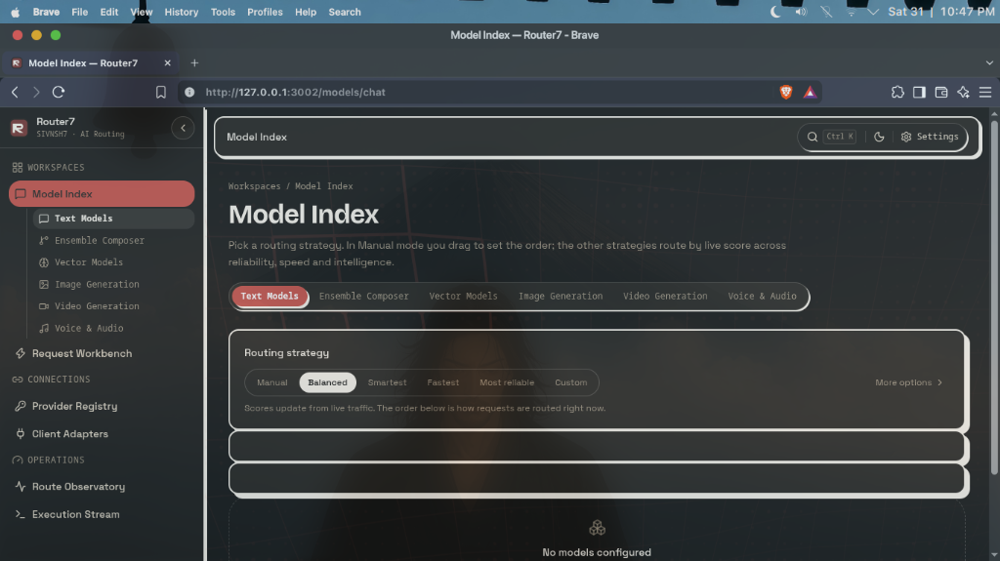

# router7 (r7)

<div align="center">
  <a href="https://github.com/sivnsh7/router7">
    
  </a>
</div>

**Router7** is an intelligent multi-provider AI Gateway and resilient failover orchestrator with an interactive Web GUI Dashboard.

Running **`r7`** or **`router7`** boots the gateway server and immediately launches the web dashboard in your browser. All configuration—provider API keys, model routing, coding agent adapters, fallback chains, and real-time logs—is managed entirely through the GUI!

---

## ⚡ Quick Start

### 1. 1-Click Automated Setup by Operating System

#### 🐧 Linux & 🍎 macOS (Bash / Zsh)
```bash
curl -fsSL https://raw.githubusercontent.com/sivnsh7/router7/main/install.sh | bash
```

#### 🪟 Windows (PowerShell)
```powershell
irm https://raw.githubusercontent.com/sivnsh7/router7/main/install.ps1 | iex
```

#### 🪟 Windows (Command Prompt / CMD)
```cmd
powershell -ExecutionPolicy Bypass -Command "irm https://raw.githubusercontent.com/sivnsh7/router7/main/install.ps1 | iex"
```

Everything will be configured automatically:
- Checks/installs Node.js v22 LTS automatically if not present
- Configures `r7` and `router7` executable launchers in PATH
- Injects aliases into your shell (`.bashrc`, `.zshrc`, PowerShell `$PROFILE`, etc.)
- You can immediately type `r7` in your terminal to start the tool!

```bash
# Using the short alias:
r7

# Or using the full name:
router7
```

### 2. Global Installation via npm
Install globally to get the **`r7`** and **`router7`** commands anywhere in your terminal:

```bash
npm install -g router7
```

### 3. Zero-Install via `npx`
Run directly on-demand without installing:

```bash
npx router7
```

---

## 🖥️ Usage & CLI Options

```bash
r7 [options]
```

| Flag | Description | Default |
| :--- | :--- | :--- |
| `-p, --port <port>` | Port to run the server on | `3001` (or `$PORT`) |
| `-h, --host <host>` | Host address to bind to | `127.0.0.1` (or `$HOST`) |
| `--no-open` | Start server without auto-opening browser | `false` |
| `-v, --version` | Print current Router7 version | |
| `--help` | Show usage options | |

### Examples

```bash
# Start server on default port (3001) and open browser
r7

# Start on a custom port
r7 --port 8080

# Run in background / headless mode (e.g. VPS or server)
r7 --no-open --host 0.0.0.0 --port 3001
```

---

## 🌐 Endpoints Served

Once started, Router7 exposes the unified API surfaces and the web console:

- **Web Dashboard**: `http://localhost:3001`
- **OpenAI Proxy**: `http://localhost:3001/v1/chat/completions`
- **Anthropic Wire**: `http://localhost:3001/v1/messages` (Claude Code drop-in)
- **Google Gemini**: `http://localhost:3001/v1beta`
- **Health Check**: `http://localhost:3001/api/ping`

---

## 🎨 100% GUI-Driven Management

No complicated CLI flags or config editing required. The interactive dashboard handles:
- **Keys Vault**: Add, encrypt, and monitor API keys for OpenAI, Anthropic, Gemini, Groq, Cerebras, DeepSeek, Mistral, Ollama, and 30+ providers.
- **Client Adapters**: One-click copy instructions and configs for Claude Code, Codex, Cline, Cursor, Continue, and Aider.
- **Dynamic Routing**: Switch between Fastest, Smartest, Balanced, Most Reliable, and Custom weighted routing strategies.
- **Ensemble Composer & Fusion**: Multi-model synthesis and consensus judging.
- **Real-Time Logs & Observability**: Stream live execution requests, latency breakdowns, and fallback events.

---

## 📜 License

MIT © [Shivansh (sivnsh7)](https://github.com/sivnsh7)
